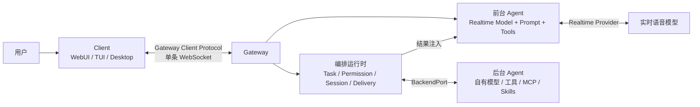
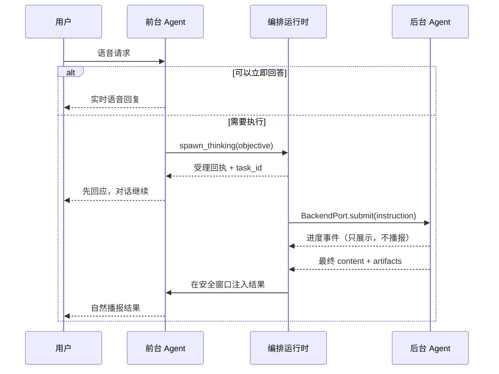

# Qwen Audio Agent 架构拆解：用实时语音运行时与 Gateway 构建自己的对话式智能体

> 本文基于 [qwen-audio-agent](https://github.com/QwenAudio/qwen-audio-agent) 的 README、`docs/architecture` 与 `examples`（2.0.x）。

## 一、它解决的不是“语音转文字”，而是“对话不中断”

一个传统的实时语音 Agent，链路通常是：

```text
麦克风 → VAD → ASR → LLM（可能调用工具）→ TTS → 扬声器
```

这条链路在闲聊时没有问题。一旦 LLM 要查订单、读文件、跑代码、调用一个耗时几分钟的外部系统，问题就出现了：**整个对话循环被这个工具调用卡住了**。用户要么干等，要么打断；打断之后，任务状态、执行上下文和最终结果又很难自然回到对话里。

qwen-audio-agent 的核心选择，是把这件事拆成两个循环：

- **对话循环**：实时模型负责听、说、理解、打断和追问，尽量不阻塞。
- **工作循环**：后台 Agent 负责真正执行任务，可以慢、可以多步、可以使用自己的模型、工具、MCP 和 Skills。

中间由一层**编排运行时**连接：它管理任务、权限、会话、事件和结果投递。对外再由 **Gateway** 把这套运行时服务化，客户端通过一条 WebSocket 接入。

所以它不是一个语音模型 SDK，也不是一套 UI 框架。更准确地说，它是：

> **一个实时语音运行时 + 一个服务化网关 + 一套客户端协议。**

## 二、三层架构：谁负责听、谁负责想、谁负责做

先把最容易混淆的地方说清楚。qwen-audio-agent 的核心逻辑组件只有三个：

| 组件 | 负责什么 | 不负责什么 |
| --- | --- | --- |
| **前台 Agent** | 用实时模型、提示词、上下文和工具完成自然交流、即时回答和轻量工具调用。 | 不管理后台 Session、不决定后台怎么执行、不处理后台协议。 |
| **编排运行时** | 管理 Task 生命周期、权限、会话、事件路由、结果投递与恢复。 | 不额外引入一个“协调模型”替后台做推理，也不替后台决定内部步骤。 |
| **后台 Agent** | 在自己的执行环境里使用自己的模型、工具、MCP、Skills 完成任务。 | 不直接面对客户端，不把自己的协议对象泄漏给前台。 |

**Gateway 不是第四个核心组件。** 它是这套运行时的服务化运行形态，负责装配、监听、认证、连接管理和协议入口。用一句话区分：

- 编排运行时描述“系统如何工作”；
- Gateway 描述“这些能力如何对外提供服务”；
- 客户端描述“用户如何输入、播放、展示和操作”。



这三个组件是**逻辑职责**，不要求分别部署成三个进程。桌面版可以把 Gateway 和后台进程都放在本机；手机、WebUI、TUI 也可以连接一台远程 Gateway。部署形态变化，不改变职责边界。

### 2.1 前台 Agent：耳朵和嘴，不是全能执行器

前台 Agent 由实时模型、提示词、上下文和工具共同构成。它的强项是低延迟交流：

- 全双工语音、自然打断、多轮上下文；
- 理解用户意图，判断“这句话能不能直接回答”；
- 调用少量轻量工具完成范围明确的动作；
- 把需要后台执行的事情交给 `spawn_thinking`。

它不负责选择后台 Session，不负责决定用哪个子 Agent，也不负责猜测后台的执行步骤。这个边界很重要：**前台 Agent 的职责是理解与表达，不是执行计划。**

### 2.2 编排运行时：Task 是一等公民

编排运行时不是一个同名的类，而是分布在 `task/`、`orchestration/`、`voice/` 等模块中的一组职责，由 `app/` 装配起来。它的核心是：

- **TaskManager**：Task 状态的唯一权威；
- **TaskOperations**：提交、查询、取消、权限决定、补充输入；
- **PermissionPolicy**：把语音、客户端命令和定时工作统一到同一套授权判断；
- **SessionTaskCoordinator**：按 owner/session 观察任务、协调待确认权限和最终结果；
- **BackendWorkRuntime**：把运行时 Task 投射成 `BackendPort` 调用；
- **Session Journal / Delivery**：持久化、回放、结果投递和播放确认。

注意，这里没有“再起一个 LLM 来协调前后台”的设计。协调是代码和状态机完成的，不是让另一个模型自由发挥。这样做的好处是可测试、可恢复、权限边界清晰；代价是运行时要为 Task、Session 和投递定义一套明确的契约。

### 2.3 后台 Agent：真正的执行环境

后台 Agent 可以是你已经熟悉的编码 Agent，比如 OpenCode、Qwen Code、Claude Code、Codex、Kimi Code、MiniMax Code；也可以是一个远程 A2A Agent；还可以是你自己写的 HTTP 服务、硬件 Agent 或任务运行时。

它通过 `BackendPort` 接入。ACP、A2A 或自定义协议的细节，全部留在各自的 Adapter 里。编排运行时只看到统一的任务语义：

- 提交一个 Task；
- 查询状态；
- 取消；
- 响应权限请求；
- 响应补充输入；
- 订阅规范化后的进度事件；
- 返回最终 `content` 和 `artifacts`。

后台内部的子 Agent、项目 Session、工具调用和文件操作，不会变成新的架构层，也不会直接暴露给前台或客户端。

### 2.4 Gateway：组合根 + 服务宿主

Gateway 做的是“把运行时装配成一个可连接的服务”：

- 装配前台 Agent、编排运行时、后台 Adapter、Realtime Provider；
- 提供 HTTP/WebSocket 入口；
- 处理认证、连接租约、能力协商、心跳和回放；
- 把内部事件投影成客户端协议事件；
- 托管 WebUI 静态资源，但**不导入 UI 组件**。

它不承载业务逻辑。客服、座舱、数字人这些场景的提示词、工具和业务状态，应该留在示例或业务宿主里，而不是塞进 Gateway。

### 2.5 客户端：I/O 与环境入口

客户端负责收音、播放、转写展示、任务卡片、窗口、唤醒词、快捷键、本地设备和环境事件。它不等于前台 Agent，也不拥有模型会话。

一个 Gateway 对每个用户只接受**一个活动 Client 连接**。新客户端可以显式接管，旧连接会断开；后台工作不会因为客户端断开而被取消。这个设计让“多端”变成“同一个会话的不同外壳”，而不是多个客户端同时操作同一份状态。

## 三、核心机制：把对话循环和工作循环拆开

这是整套架构最值得看的部分。

### 3.1 `spawn_thinking`：受理，而不是等待

当用户提出一个需要执行的任务，前台 Agent 调用：

```text
spawn_thinking(objective)
```

这个工具**永远不会等待任务完成**。它只做一件事：让编排运行时创建一个 Task，然后立刻返回受理回执和 `task_id`。



用户不会因为后台在查资料、跑代码或调用工具而被迫沉默。后台执行期间，用户仍然可以继续说话、追问、修改要求，甚至开始另一项工作。

这和普通 function calling 有本质区别：

- function calling 是“同一轮里等工具结果”；
- `spawn_thinking` 是“把工作变成一个有空生命周期的 Task”，对话先继续。

### 3.2 任务准入：有界队列，而不是无限并发

Task 被受理后进入有界队列。默认情况下，全局和每个 owner 各有一个活动名额；名额被占用时，后续请求排队。

这带来两个效果：

- 不会因为用户连续说了十件事，就把十个后台任务同时打满；
- 排队是运行时内部调度细节，不会改变用户的双工对话体验。

ACP 后台还有自己的协调 Session 机制：协调轮次负责分派和整理结果，项目 Session 可以独立执行。任务准入上限不会创建额外的协调 Session，也不限制独立项目 Session 的数量。A2A 或自定义后台不要求采用同样的 Session 结构。

### 3.3 Task 状态：交付回执，不是后台任务图的镜像

Task 的公共状态大致是：

```text
queued → running ─────────────────────────→ completed
   │        └→ delegated → finalizing ────────┘
   └────────────→ cancelling → cancelled
                            ↘ failed
```

关键点：

- UI 把 `queued` 和 `running` 都呈现为“处理中”，队列位置不暴露给用户；
- Task 记录只包含用户请求、时间戳、最终结果/错误、通用活动、权限摘要和通知状态；
- 后台的 Session ID、子 Agent ID、原始权限载荷、执行拓扑，不进入公共 Task；
- 排队中和直接执行中的 Task 在 Gateway 重启后无法安全恢复，会明确失败；委派 Task 只有在 Adapter 能确认持久化 Session 时才重新挂接。

### 3.4 结果交付：等一个安全的插入窗口

后台完成后，结果不会立刻硬插进语音里。运行时会等待一个安全的双工插入窗口：

- 用户正在说话时，先等；
- 有另一条回复正在生成时，先等；
- 结果开始播放后，不会因为中途打断而反复重播；
- 播放确认由客户端的 `playback.started` / `playback.ended` 回执驱动，而不是“服务端生成完就算送达”。

同时，**进度不是控制，也不产生语音播报**。工具名、计划进度、通用思考信号和 Session 标题会被投射成有界的活动，用于 UI 展示；它们不会变成语音状态更新，也不会影响任务队列。

这也是为什么它能让 Agent “始终在场”：用户听到的是对话，后台看到的是工作，两者由运行时在正确的时间点缝合。

## 四、实时边界：前台 Agent 能做什么，不能做什么

前台 Agent 的工具面被刻意收窄。它分为两类：

| 契约 | 工具 |
| --- | --- |
| **核心契约** | `spawn_thinking`、`update_agent_task`、`get_agent_task_status`、`cancel_agent_task`、`respond_permission`、`get_current_time` |
| **可选能力** | `memory`、`web_search`、`fetch_url`、`knowledge`、`recall`、`notes`、`schedule_reminder`、`enter_sleep`，以及按配置启用的动态 MCP 工具 |

核心工具负责稳定的对话流程：受理工作、调整工作、查询状态、取消、确认权限。可选工具按配置和能力动态出现；没有配置后台时，`spawn_thinking` 和 `update_agent_task` 不会提供。

前台 Agent **没有**这些能力：

- 选择、创建、继续或取消后台 Session；
- 选择同步、异步、前台或后台执行；
- 选择后台执行策略；
- 选择工具、Agent 或子 Agent。

唯一的例外是 `respond_permission`：它只能转发当前轮次用户对某个待确认权限的明确决定，不能在没有用户话语的情况下虚构同意，也不能修改后台的权限策略。

这个设计的意义是：**模型可以理解意图，但不能拥有基础设施的控制权。** 权限、路由、Task 生命周期和后台 Session 都由运行时管理，不依赖模型“遵守提示词”。

## 五、后台边界：BackendPort 与四种接入方式

`BackendPort` 是编排运行时和后台 Agent 之间的协议中立边界。一个 Adapter 必须实现：

```text
describe / start / health / submit / status / cancel /
respondAuthorization / respondInput / subscribe / close
```

其中最关键的是 `submit(task)`：

- 面向模型的输入只能包含 `instruction` 和协议原生附件；
- 不得把整个 Task、ID、owner、生命周期、ASR 原文、工作目录、时区、前台记忆或聊天历史序列化进 Prompt；
- 最终结果至少返回 `{ content, artifacts }`；
- `content` 是前台理解、概括和自然播报的唯一事实文本；
- Adapter 不得另行指定播报话术，也不得在结果里暴露原始协议对象、Session ID 或凭据。

进度通过 `subscribe` 发布规范化事件，比如 `backend.activity`、`backend.message`、`backend.artifact`、`backend.permission.requested`、`backend.input.requested`。这些事件先由 Adapter 归一化，再进入 TaskManager；ACP 的 `session/update`、A2A 的流式事件和自定义回调，都不能把原始载荷直接传给前台。

接入方式有四种，按代码量从少到多：

| 路径 | 适合什么 | 做法 |
| --- | --- | --- |
| **通用 ACP** | 目标 Agent 已经会说 ACP | 配置 `AGENT_PROTOCOL=acp`、`ACP_COMMAND`、`ACP_ARGS`，零代码。 |
| **远程 A2A** | 目标 Agent 是一个 A2A 服务 | 用 `createA2ABackendAdapter` 接到 Gateway，代码很少。 |
| **自定义 BackendPort** | HTTP 服务、硬件 Agent、电话 Agent、自有任务运行时 | 用 Backend Adapter SDK 实现十个方法。 |
| **一等公民 ACP 后台** | 想做产品级集成、一键安装和桌面引导 | 需要目录条目、Agent Driver、可选的 Runtime Driver。 |

对大多数“我自己的智能体”来说，前三条路径已经足够。第四条是给想要深度集成到 qwen-audio-agent 产品体系里的团队准备的。

### 5.1 ACP 与 A2A 的差别

ACP Adapter 为每个 owner 和后端维护一个持久协调 Session。请求、调整和结果整理共用 FIFO 队列；委派出去的项目 Session 可以独立执行。它的优势是能复用编码 Agent 自己的工具、MCP、Skills 和认证。

A2A Adapter 更适合远程服务。它通过 Agent Card 发现、协议协商、Task 查询/取消和 Artifact 解码，把远程 Agent 接到同一个 `BackendPort`。设置 `reuseContext: true` 后，同一 owner 的后续任务可以复用服务端返回的 `contextId`，但**历史仍由远端 Agent 自己保留**；前台聊天记录不会自动转发。

两者都不改变网关、Task Runtime、语音前台和客户端使用的公共契约。协议对象只存在于 Adapter 内部。

### 5.2 进程归属：owned 还是 external

后台生命周期由 `owned` / `external` 模型管理：

- `owned`：Gateway 启动本地后台进程，并在退出时停止它；
- `external`：Gateway 只连接外部服务，不启动、不改端口、不停止它。

后台服务归属和 ACP 连接方式是两个独立维度。比如 OpenClaw 可以是外部 Gateway 服务，但 ACP 连接仍然由本地 bridge 通过 stdio 完成。理解这一点，才能正确设计“桌面版内置 Gateway + 远程后台”的部署。

## 六、语音边界：Realtime Provider

Realtime Provider 是运行时与实时语音模型之间的适配器。它拥有自己的：

- URL、认证、模型和音色；
- 上游 Session；
- 错误分类；
- 握手帧；
- 事件编码/解码；
- 工具结果续答语义；
- 输入/输出采样率。

Gateway 只看到统一的实时事件，不关心上游是 Qwen Audio Realtime、OpenAI Realtime、Gemini Live、豆包 Seeduplex、StepAudio，还是本地部署的 Speech-to-Speech 或 MiniCPM-o。

官方支持的前台包括云端和本地两类：

- 云端：Qwen Audio 3.0/3.1 Realtime、GPT-Live / OpenAI Realtime、Google Gemini Live、Qwen3.5-Omni Realtime、Qwen3.8 Omni Flash Realtime、豆包 Seeduplex 3.0、StepAudio 3；
- 本地：Hugging Face Speech-to-Speech、MiniCPM-o 4.5。

不同 Provider 的能力并不完全一致。比如视觉输入、工具调用、原生续答、临时回复指令、会话恢复，各自的支持程度不同。Gateway 通过能力协商暴露这些差异，而不是假设“同一家 API 的所有模型都一样”。

如果你要接入自己的语音模型，实现 Provider 契约并注册到 `createRealtimeProviderRegistry` 即可。任务、权限、客户端协议都不需要改。

## 七、Gateway：把运行时变成服务

Gateway 对外讲的是 **Gateway Client Protocol（GCP）**，而不是 ACP、A2A 或 OpenAI Realtime 的复刻。它有自己的握手、能力协商、事件信封和生命周期；只是在语义上刻意对齐了这些标准里熟悉的概念。

### 7.1 一条 WebSocket，先握手再说话

客户端连接：

```text
ws://<gateway>/api/realtime
```

当前第一方客户端使用 7.0 线协议；旧的 `connect` 仅作为兼容别名保留。

第一条消息必须是 `session.hello`，声明客户端身份、连接配置、输入能力和期望的 capability。Gateway 返回 `session.ready`，给出协商后的协议版本、Session ID 和能力交集。

几个重要规则：

- 同一用户同一时刻只有一个活动 Client；默认收到 `client_occupied` 后关闭；
- 协商了 `session.takeover` 的客户端可以显式接管，Gateway 会关闭旧连接并授予新的租约代次；
- 客户端必须按 capability 分支，而不是比较产品版本号；
- 协议版本、客户端身份和能力不能在当前连接中改变，需要改变就重连；
- 心跳使用 `session.ping` / `session.pong`，正常业务消息也会续租；
- 断线后可以用 `session.replay` 按 `sequence` 回放有界的服务端推送，但媒体增量、转写增量和即时命令结果不会回放。

### 7.2 音频走快速路径，语义输入才进路由

原始音频帧不进入语义路由器。客户端通过 `input_audio_buffer.append` 发送 base64 PCM16 单声道音频，采样率取 `voice.ready` 返回的 `inputSampleRate`；输出音频通过 `audio.delta` 携带 base64 和 `sampleRate` 播放。

只有已经提交的语义输入（文本、图片、文件、混合 Part）才进入 `GatewayEventRouter`。这也是低延迟的关键：音频流和模型增量不应该被任务队列、权限检查或事件投影拖慢。

### 7.3 控制面：Task、权限、补充输入和回放

同一个 WebSocket 上还有一组运行时命令：

| 命令 | 作用 |
| --- | --- |
| `task.create` | 显式创建一个异步 Task，不伪装成对话输入 |
| `task.update` | 用 `task_id` 调整指定 Task |
| `task.get` / `task.list` | 查询单个 Task 或有界快照 |
| `task.cancel` | 请求取消 Task，最终状态由生命周期事件报告 |
| `permission.respond` | 处理待确认权限 |
| `task.input.respond` | 把补充输入交回同一 Task |
| `conversation.history` | 读取有界、对 Client 安全的对话投影 |
| `session.output_voice.update` | 更新当前会话的输出音色 |
| `session.replay` | 从 sequence 游标回放服务端推送 |

`task.create` 是显式集成命令，不是常规语音聊天路径。正常的语音请求仍然由前台 Agent 通过 `spawn_thinking` 创建 Task，以保留它的路由判断和自然承接行为。

### 7.4 Client Event 与 Client Action：一个描述发生了什么，一个要求做什么

这是协议里很容易混淆、但设计得很清楚的一对概念：

- **Client Event**：客户端告诉 Gateway “发生了什么”。比如用户触摸了水杯、车辆状态变化、摄像头开关变化。它只更新上下文，不直接执行动作；不能被伪造成 Task、权限或后台生命周期事件。
- **Client Action**：Gateway 要求客户端“执行一个环境动作”，并等待结果。比如让桌面客户端进入休眠。它是有 capability 约束的请求/结果模型。

事件走 `client.event.publish`，动作走 `client.action.request` / `client.action.result`。两者都不允许客户端把自己的 JSON 直接塞进模型 Prompt；Gateway 会通过 Event Policy 决定它是确定性处理、只进入上下文、稍后回复还是立即回复。

### 7.5 访问边界

默认情况下，Gateway 只监听 `127.0.0.1`，本机回环访问零配置。需要局域网或远程访问时：

- `--lan` 只面向可信局域网，不支持直接暴露公网；
- 远程 HTTP/WebSocket 必须使用访问密钥或可撤销的设备令牌；
- 原生客户端在 WebSocket 握手使用 `Authorization: Bearer <token>`；
- 浏览器通过 WebSocket 子协议携带同一 Token；
- 远程浏览器来源必须显式写入 `QWEN_AUDIO_AGENT_ALLOWED_ORIGINS`；
- 生产部署应使用 VPN 或 HTTPS/WSS 反向代理。

### 7.6 可选 WebRTC

默认媒体走 WebSocket 上的 base64 PCM。需要把媒体从 WebSocket 的 base64 PCM 换成 WebRTC 传输时，可以启用可选的 WebRTC 路径；它复用同一套网关控制与生命周期语义，不改变上游 Realtime Provider 协议。

## 八、三种官方客户端

第一方参考客户端有三个：WebUI、TUI 和桌面悬浮球。它们不是三套协议，而是同一个 Gateway Client Protocol 的不同 I/O 外壳。

| 客户端 | 形态 | 适合场景 | 关键特点 |
| --- | --- | --- | --- |
| **WebUI** | 浏览器页面 | 本机或远程浏览器访问、快速体验 | Gateway 同源静态托管，无需单独部署前端；全双工语音、文本/附件、任务视图、资料库。 |
| **TUI** | 终端界面 | 服务器、SSH、开发和调试 | macOS 默认全双工 + AEC；Linux/Windows 默认半双工，用 `/interrupt` 打断；支持文本、图片和文件附件。 |
| **Desktop** | Electron 悬浮球 + 对话面板 | 常驻桌面的个人助理 | 内置 Gateway；悬浮球、自动休眠、唤醒词、桌宠皮肤；也可以连接远程 Gateway。 |

它们共享同一套握手、能力协商、Task 命令、权限决策和回放逻辑。一个 Gateway 对每个用户只允许一个活动客户端；切换设备时需要显式接管，旧连接断开，但后台工作不受影响。

除了这三个，官方示例里还有手机远程连接、AI Passport 硬件客户端、WebRTC 客户端等形态。它们仍然接在同一套协议上，只是 I/O 和设备侧实现不同。

## 九、如何开发自己的实时对话智能体

先把“自己的智能体”拆成几个问题：

1. 你已经有 Agent 了吗？它是 ACP、A2A，还是只有 HTTP/自定义协议？
2. 你需要替换语音模型吗？
3. 你需要自己写客户端吗？
4. 你的业务工具应该在前台直调，还是交给后台？

对应到 qwen-audio-agent 的接入点：

| 你已有的东西 | 最短路径 | 代码量 |
| --- | --- | --- |
| 一个会说 ACP 的 Agent | 配置 `AGENT_PROTOCOL=acp`，用现成 Gateway + WebUI | 零代码 |
| 一个 A2A Agent | `createA2ABackendAdapter` + `createGatewayApplication` | 几十行 |
| 一个 HTTP/自定义 Agent | 实现 `BackendPort` Adapter | 一个适配器 |
| 只有实时模型，没有后台 | 仅前台模式 + 前台 MCP/OpenAPI 工具 | 配置为主 |
| 有自己的语音模型 | 实现 `RealtimeProvider` | 一个 Provider |
| 有自己的 UI/设备 | 用 `GatewayClient` SDK 或直接实现 GCP | 一个客户端 |

### 9.1 零代码：接入已有的 ACP Agent

如果目标 Agent 已经支持 ACP，直接配置即可：

```dotenv
AGENT_PROTOCOL=acp
ACP_COMMAND=your-agent
ACP_ARGS=["--acp"]
# 可选：需要透传给 Agent 进程的环境变量名
QWEN_AUDIO_AGENT_ACP_FORWARD_ENV=MY_AGENT_API_KEY
```

然后启动 Gateway 和客户端：

```bash
qwenaudio config
qwenaudio          # 终端 1：Gateway
qwenaudio webui    # 终端 2：浏览器界面
```

这条路径适合“我已经有一个能办事的编码 Agent，只想要一个语音前台”的场景。后台继续使用自己的模型配置、工具、MCP、Skills 和认证。

### 9.2 最短代码：接入一个 A2A Agent

如果你已经有一个独立的 Agent 服务，最省事的方式是让它说 A2A，然后用官方 Adapter 接到 Gateway：

```js
import { createGatewayApplication } from 'qwen-audio-agent/gateway-application'
import { createBackendAgentHost } from 'qwen-audio-agent/backend-adapter-sdk'
import { createA2ABackendAdapter } from 'qwen-audio-agent/a2a-backend-adapter'

const backend = createA2ABackendAdapter({
  agentCardUrl: 'http://127.0.0.1:3020/.well-known/agent-card.json',
  label: 'My Agent',
  reuseContext: true,
})

const agent = createBackendAgentHost(backend, { name: 'My Agent' })
const application = createGatewayApplication({ agent, autoStart: false })
const server = application.start({ host: '127.0.0.1', port: 3101 })

process.once('SIGTERM', async () => {
  await application.close()
  await agent.close()
})
```

这段代码就是智能座舱和客服示例的 Gateway 装配方式。`reuseContext: true` 会让同一用户的后续任务复用 A2A Context；是否保留历史、保留多少轮，由远端 Agent 自己决定。

### 9.3 完全控制：实现一个 BackendPort Adapter

如果你的 Agent 说的是 HTTP、WebSocket、私有 RPC，或者你根本不想引入 ACP/A2A，直接实现 `BackendPort`：

```js
import {
  BackendEventType,
  backendEvent,
  defineBackendAdapter,
} from 'qwen-audio-agent/backend-adapter-sdk'

export const myAgentAdapter = defineBackendAdapter({
  describe() {
    return {
      configured: true,
      enabled: true,
      protocol: 'my-agent',
      label: 'My Agent',
      capabilities: {
        cancel: true,
        workUpdates: true,
        authorization: true,
        inputRequests: true,
      },
    }
  },

  async start() {
    // 幂等：校验配置、建立连接，重复调用不能产生副作用。
  },

  async health() {
    return { ok: true, status: 'ready' }
  },

  async submit(work, { signal, onEvent }) {
    // work.instruction 是唯一允许作为模型输入的任务文本。
    onEvent?.(backendEvent(BackendEventType.ACTIVITY, {
      activity: {
        id: 'lookup',
        kind: 'tool',
        status: 'running',
        label: '查询中',
      },
    }))

    const result = await myAgent.run(work.instruction, { signal })
    return {
      content: result.text,
      artifacts: result.artifacts ?? [],
    }
  },

  async status(taskId) {
    return taskId ? myAgent.status(taskId) : { ok: true }
  },

  async cancel(taskId) {
    return myAgent.cancel(taskId)
  },

  async respondAuthorization(taskId, permissionId, decision) {
    return myAgent.decide(taskId, permissionId, decision)
  },

  async respondInput(taskId, inputRequestId, response) {
    return myAgent.answer(taskId, inputRequestId, response)
  },

  subscribe(listener) {
    return myAgent.on('event', listener)
  },

  async close() {
    await myAgent.close()
  },
})
```

然后把它装进 Gateway：

```js
import { createGatewayApplication } from 'qwen-audio-agent/gateway-application'
import { createBackendAgentHost } from 'qwen-audio-agent/backend-adapter-sdk'
import { myAgentAdapter } from './my-agent-adapter.mjs'

const agent = createBackendAgentHost(myAgentAdapter)
const application = createGatewayApplication({ agent, autoStart: false })

application.start({ host: '127.0.0.1', port: 3101 })
```

实现时注意几件事：

- `start` 和 `close` 必须幂等；
- `submit` 要支持 `AbortSignal`，取消时不能把“已中止”当成“执行成功”；
- 进度用 `backend.activity` / `backend.message` / `backend.artifact` 发布，不要泄漏原始协议对象；
- 需要权限确认时发 `backend.permission.requested`，然后等待 `respondAuthorization`；
- 需要向用户追问时发 `backend.input.requested`，并让 `submit` 保持等待，直到 `respondInput` 恢复同一次操作；
- 支持“调整已接受的工作”时，声明 `capabilities.workUpdates` 并实现 `update`；返回的 `{ completion }` 只表示投递确认，不表示工作完成；
- 需要续接已结束的工作时，可以在结果里返回私有 `continuation: { adapter, token }`，后续 `submit` 会把它作为 `resumeContext` 交回；
- 最后跑一遍 `verifyBackendAdapterConformance`，它会验证幂等启动/关闭、结果边界、事件隔离、owner 隔离、取消和订阅清理。

这条路径适合“我的 Agent 有自己的运行时，不想为了接语音而改造成 ACP/A2A”的情况。你只需要把任务语义翻译成 `BackendPort`，剩下的 Task、权限、结果交付和客户端协议都是现成的。

### 9.4 给前台加工具：MCP、OpenAPI 与 Profile

不是所有能力都值得交给后台。查询天气、读一条订单、开关车灯这类低延迟、只读或确定性操作，直接放在前台更快。

用前台 MCP 配置一个工具面：

```json
{
  "version": 1,
  "servers": {
    "orders": {
      "enabled": true,
      "transport": {
        "type": "streamable-http",
        "url": "https://mcp.example.com/mcp",
        "headers": {
          "authorization": "${ORDER_MCP_TOKEN}"
        }
      },
      "tools": {
        "get_order": { "enabled": true, "timeoutMs": 8000 },
        "list_orders": { "enabled": true }
      }
    }
  }
}
```

```dotenv
QWEN_AUDIO_FRONTEND_MCP_CONFIG=/absolute/path/to/frontend-mcp.json
ORDER_MCP_TOKEN=replace-me
```

模型看到的工具名是稳定的 `mcp__<server>__<tool>`。只有显式启用的工具才会暴露；工具描述、调用次数、超时和结果大小都有边界。OpenAPI 3.x 也可以用同样的方式接入。

如果想把“人设 + 工具配置”打包成一套可分享的前台体验，可以用 Frontend Profile：

```text
my-profile/
├── frontend-profile.json
├── ASSISTANT.md
└── tools/
    ├── mcp.json
    └── openapi.json
```

然后设置 `QWEN_AUDIO_FRONTEND_PROFILE=/absolute/path/to/frontend-profile.json`。Profile 不引入新的插件协议，也不会修改核心 Prompt。

### 9.5 写自己的客户端：GatewayClient SDK

如果你要做自己的 App、硬件或网页，不需要复刻 WebUI。用共享的 `GatewayClient`：

```js
import {
  GatewayClient,
  GatewayClientCapability,
} from 'qwen-audio-agent/gateway-client-sdk'

const client = new GatewayClient({
  url: 'ws://127.0.0.1:3101/api/realtime',
  createSocket: url => new WebSocket(url),
  clientType: 'my-client',
  clientInstanceId: 'my-client-1',
  capabilities: [
    GatewayClientCapability.INPUT_AUDIO,
    GatewayClientCapability.INPUT_TEXT,
    GatewayClientCapability.PLAYBACK_RECEIPTS,
    GatewayClientCapability.TASK_COMMANDS,
  ],
  onEvent(event) {
    if (event.type === 'audio.delta') {
      // event.audio, event.sampleRate, event.responseId
    }
    if (event.type === 'transcript.final') {
      // 展示用户/助手最终转写
    }
  },
  onAction(action) {
    // Gateway 请求客户端执行环境动作
    return { status: 'completed', output: {} }
  },
})

client.start()
client.send({ type: 'conversation.item.create', text: '你好' })
```

SDK 会处理 `session.hello` / `session.ready`、命令关联、Client Action、断线重连和状态恢复。你仍然需要自己负责：

- 麦克风采集和 PCM16 编码；
- `audio.delta` 的播放队列；
- `playback.started` / `playback.ended` 回执；
- UI、任务卡片、权限弹窗和设备侧逻辑。

这就是“运行时和 Gateway 是你的，产品体验也是你的”的方式。

## 十、设计自己的 Agent 时，怎么切前台和后台

这是接入后最容易做错的部分。工具放错层，延迟和可靠性都会出问题。

### 10.1 按“延迟 × 风险 × 时长”切

一个实用的判断表：

| 操作特征 | 放在前台 | 放在后台 |
| --- | --- | --- |
| 只读、低延迟、结果小 | ✅ 例如查天气、查订单、读状态 | |
| 写操作、不可逆、涉及金额 | | ✅ 预览 + 确认 + 提交 |
| 多步骤、长时间、需要文件/代码/外部系统 | | ✅ 交给后台 Agent |
| 需要组合多个工具并做计划 | | ✅ 后台更合适 |
| 需要即时反馈的 UI 动作 | ✅ 例如开关灯、播放/暂停 | |

智能座舱示例就是按这个原则切的：38 个场景工具里，37 个走前台 MCP，1 个闪购走后台；车控、导航、音乐、天气都要求低延迟，而闪购涉及下单和外部服务，适合后台。

座舱的评测数据也给了一个直观参考：前台直调的平均工具返回是 1.48 秒，后台委托是 3.56 秒（单位是工具返回时延，不含播报和实车动作；非配对样本）。这不是说后台一定慢，而是说**能直接回答的事情不要绕后台**。

### 10.2 `objective` 要自包含

`spawn_thinking` 的 `objective` 不是执行计划，而是对用户请求的保守解释。提交前要把“继续那个页面”“把刚才那个订单取消掉”这类指代解析成自包含指令。

不要指望后台 Agent 能看到完整的 ASR 原文、前台工具结果或长期记忆。运行时会附带最多 2,000 字符的新增人机对话作为背景，但它的作用是帮助理解，不是第二份任务描述。

### 10.3 写操作要“预览 → 确认 → 提交”

客服示例把这一点做得很完整：

- 后台先返回一个可读预览；
- 客户明确同意后，前台通过 `update_agent_task` 把答复交回同一 `task_id`；
- 后台结合保存的预览解释答复，只有真实同意才提交；
- 拒绝、取消、超时都会撤销待确认批准；
- 每次写操作都要重新取得批准，不共用同意。

权限不是靠 Prompt 保证的。Gateway 有 `PermissionPolicy`，后台 Adapter 有 `respondAuthorization`，客户端有 `permission.respond`。模型可以理解“可以”或“不允许”，但不能在没有当前轮次用户话语的情况下虚构同意。

### 10.4 进度和结果分开

- 进度：工具名、计划、通用活动 → UI 展示，不播报；
- 结果：最终 `content` + `artifacts` → 前台理解、概括、自然播报；
- 文件/图片/结构化结果 → `artifacts`，由客户端决定怎么展示。

不要让后台 Adapter 直接写“播报话术”。它只提供事实；怎么说得自然，是前台 Agent 的事。

### 10.5 Session、记忆和知识库不是一回事

- **后台 Session**：执行上下文，由 ACP/A2A/自定义 Adapter 管理；
- **前台会话**：一段语音与文字对话，新建会话不清空长期记忆；
- **长期记忆**：`MemoryProvider`，保存用户偏好和事实；
- **知识库**：`KnowledgeProvider`，检索资料和文档。

它们可以组合，但不要混为一谈。A2A 的 `reuseContext` 复用执行上下文，不等于长期记忆；前台聊天记录也不会自动变成后台历史。

### 10.6 安全边界要靠运行时，不靠提示词

- 客户端不能伪造 Task、权限或后台生命周期事件；
- 原始音频不进语义路由器；
- 后台原始协议对象不能穿过 `BackendPort`；
- 客户端事件不能直接成为模型指令；
- 远程访问必须认证，默认只监听回环；
- 后台子进程只拿到自己声明的凭证命名空间，不继承 Gateway 的其他密钥。

这些是架构层面的约束。写 Prompt 时当然要要求模型遵守规则，但安全不能只依赖模型遵守。

## 十一、官方示例怎么选

| 示例 | 展示了什么 | 建议什么时候看 |
| --- | --- | --- |
| **智能座舱** | 38 个 MCP 工具、前后台工具分流、A2A 后台、React 客户端、状态同步 | 想做“设备/业务领域 Agent”，尤其是前后台工具怎么切 |
| **客服语音助手** | A2A 后台、前后台共享 MCP 业务状态、预览/确认/提交、人工坐席、Policy 配置台 | 想做涉及写操作、金额、审批和业务状态的 Agent |
| **X-Omni** | 视觉对话、按需截图、持续观察、Qwen Omni / MiniCPM-o | 想做“能看”的实时语音 Agent |
| **LightRAG** | `KnowledgeProvider`、外部知识库、仅前台模式 | 想接自己的 RAG/知识系统 |
| **VoiceMem / Memcode** | `MemoryProvider`、长期记忆、外部记忆服务 | 想做跨会话个性化 |
| **AI Passport** | 硬件语音客户端、局域网转发、半双工 | 想做硬件/嵌入式客户端 |
| **WebRTC** | 客户端到 Gateway 的可选媒体传输 | 想优化音频传输 |

如果只看两个，建议先看**智能座舱**和**客服语音助手**：前者教你怎么切工具面，后者教你怎么处理“需要用户确认的写操作”。

## 十二、边界与生产化清单

qwen-audio-agent 的能力边界很清晰，落地前建议逐项确认：

- **Node 版本**：需要 Node.js 22.22.2+ 或 24.15.0+，npm 10+；
- **语音凭据**：默认使用 DashScope 的 Qwen Audio Realtime，需要百炼 API Key；也可以换其他 Provider；
- **后台凭据**：前台 Key 不代表后台已登录，后台沿用 Agent 自己的配置；
- **示例不是生产系统**：客服、座舱等示例包含本地内存状态、管理接口和简化鉴权，不能直接当多租户生产方案；
- **Task 恢复有限**：排队中和直接执行中的 Task 在 Gateway 重启后会 failed；委派 Task 只有 Adapter 能确认持久化 Session 时才恢复；
- **一个用户一个活动 Client**：没有 Observer 或多客户端并发控制；切换设备要设计接管体验；
- **远程暴露要谨慎**：默认只监听 `127.0.0.1`；远程用 VPN 或 HTTPS/WSS，不要直接公开端口；
- **模型能力有差异**：视觉、工具调用、原生续答、会话恢复不是所有 Provider 都一样，按 capability 协商；
- **示例的会话隔离可能是进程级固定值**：有些示例的 MCP `sessionId` 在进程启动时固定，不能直接当多客户并发方案；
- **成本与延迟要实测**：前台直调和后台委托是两条链路，工具返回、播报、外部服务都会影响体感。

## 十三、总结

qwen-audio-agent 最值得借鉴的，不是“它支持了多少个语音模型”，而是它对实时语音 Agent 的架构拆分：

- **前台 Agent** 负责听、说、理解和轻量决策；
- **编排运行时** 负责 Task、权限、会话、事件和结果交付；
- **后台 Agent** 负责真正执行，保留自己的模型、工具、MCP 和 Skills；
- **Gateway** 把运行时服务化，客户端通过一条 WebSocket 接入；
- **Client** 负责 I/O、展示和环境动作。

如果你要基于它开发自己的实时对话智能体，最推荐的路径是：

1. 用 **Gateway** 承载运行时和协议；
2. 用 **A2A Adapter** 或 **自定义 BackendPort** 接入你自己的 Agent；
3. 用 **前台 MCP/OpenAPI** 把低延迟、只读、确定性的工具留在前台；
4. 用 **WebUI / TUI / Desktop** 或 **GatewayClient SDK** 做你的客户端；
5. 只有语音模型确实特殊时，才去写 **Realtime Provider**。

不需要 fork 整个产品。它的价值就在于：把“实时对话”和“异步办事”这两个本来会互相拖累的循环拆开，然后用一套稳定的边界把它们重新接起来。

## 参考资料

- 仓库：[QwenAudio/qwen-audio-agent](https://github.com/QwenAudio/qwen-audio-agent)
- 架构总览：[docs/architecture/overview.zh.md](https://github.com/QwenAudio/qwen-audio-agent/blob/main/docs/architecture/overview.zh.md)
- 详细架构：[docs/architecture/deep-dive.zh.md](https://github.com/QwenAudio/qwen-audio-agent/blob/main/docs/architecture/deep-dive.zh.md)
- 客户端协议：[docs/gateway-protocol.zh.md](https://github.com/QwenAudio/qwen-audio-agent/blob/main/docs/gateway-protocol.zh.md)
- Backend Adapter SDK：[docs/reference/backend-adapter-sdk.zh.md](https://github.com/QwenAudio/qwen-audio-agent/blob/main/docs/reference/backend-adapter-sdk.zh.md)
- 示例索引：[docs/scenarios/index.zh.md](https://github.com/QwenAudio/qwen-audio-agent/blob/main/docs/scenarios/index.zh.md)
