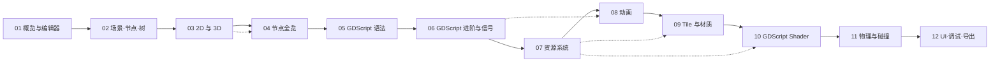

# Godot 4.x 学习系列

本系列按 **编辑器 → 节点 → 脚本 → 资源 → 内容（动画/Tile/材质/Shader）→ 物理 → 收尾（UI/调试/导出）** 的顺序串起 Godot 4.x 的完整知识链，每章配套可独立运行的最小示例与编辑器/Inspector 截图。

## 与 webgpu / rust 系列的关系

| 已发布系列 | Godot 系列的差异化定位 |
| --- | --- |
| [WebGPU 进阶](../webgpu/) | GPU 渲染底层原理 |
| [Rust 中高级](../rust-lang/) | 编程语言与运行时机制 |
| [Rust 前端工具链](../rust-tools/) | 工具链源码剖析 |
| **Godot 4.x（本系列）** | 引擎层的「节点 + 场景 + 资源 + 渲染 + 物理」一体化实战 |

学习 Godot 之所以有价值，是因为它把图形渲染、游戏物理、UI、动画、序列化都做了**引擎级整合**，让你不必自己拼装 WebGPU + Cannon.js + 自定义 UI 框架——也正因如此，必须先理解**节点树与场景化思想**，这是 Unity / Unreal 与 web 框架最大的认知差异。

## 读者画像

- 接触过一些 web 前端 / TypeScript / Python，对编程基础有信心
- 想做 2D 或 3D 游戏，但对 Unity/Unreal 的学习曲线望而却步
- 听过 Godot 但被「节点-场景-信号」这套概念劝退过
- 想搞清楚每个节点 / 每段代码在编辑器里的实际操作步骤
- 不怕字数长，希望一篇文章把一个主题讲透

## 建议阅读顺序



## 配套 Demo 仓库

[`godot-demo/`](https://github.com/shenjunjian/wasm-road-blog/tree/main/godot-demo/) 下按章节分子目录，每个子目录是一个**独立可打开**的 Godot 4.x 项目（带 `project.godot`）。读者可以直接用 Godot 4.x 打开任一子目录运行对应章节的示例。

## 章节目录

| # | 文章 |
| --- | --- |
| 01 | [概览与编辑器入门](./01-overview.md) |
| 02 | [核心概念：场景、节点、树与继承](./02-scene-tree.md) |
| 03 | [2D 与 3D：选型与关键区别](./03-2d-vs-3d.md) |
| 04 | [节点类型全览与重要节点详解](./04-node-types.md) |
| 05 | [GDScript 语法基础](./05-gdscript-syntax.md) |
| 06 | [GDScript 进阶、信号与运行时 API](./06-gdscript-advanced.md) |
| 07 | [资源系统与文件系统](./07-resources.md) |
| 08 | [动画系统：AnimationPlayer 与 AnimationTree](./08-animation.md) |
| 09 | [2D TileMap / TileSet 与 3D 材质](./09-tile-material.md) |
| 10 | [GDScript Shader 编写](./10-shader.md) |
| 11 | [物理系统 2D / 3D 与碰撞检测](./11-physics.md) |
| 12 | [UI、调试与跨平台导出](./12-ui-debug-export.md) |

## 通用约定

- **Godot 版本**：本系列全程基于 **Godot 4.3+**（4.x 体系），不覆盖 Godot 3.x。
- **截图**：每章所需截图统一放到 `public/godot/<章节序号>-<主题>.png`，正文中以 `` 引用。
- **示例代码**：每章结尾给出可直接运行的最小示例；章节内联的语法示例标 ` ```gdscript `。
- **原理优先**：每个概念会先讲「为什么这么设计」再讲「怎么用」，与本站「搞懂 GPU 实际在干嘛」的写作哲学保持一致。
